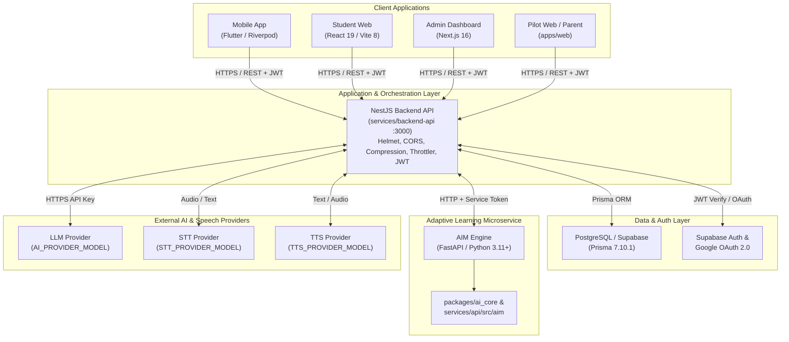
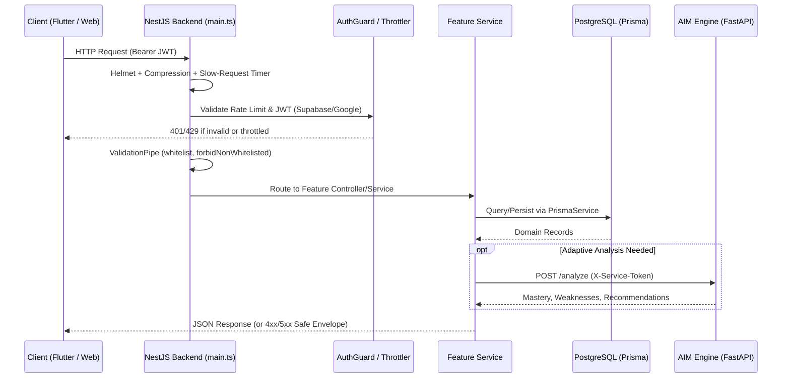

# 01 — System Architecture

## 1. Architectural Patterns Used
1. **Polyglot Microservices / Service-Oriented Architecture (SOA)**:
   - `services/backend-api` (NestJS / TypeScript) handles client-facing REST APIs, authentication, database persistence, billing, and external AI/STT/TTS orchestration.
   - `services/aim-engine` (FastAPI / Python) handles adaptive-learning computation and analysis.
2. **Modular Monolith (within NestJS)**:
   - `services/backend-api/src/features/` organizes 30+ domain modules (`auth`, `ai-teacher`, `voice-teacher`, `aim`, `curriculum`, `billing`, etc.) under `FeaturesModule`.
3. **Feature-Sliced / Clean Layering (Mobile & Web)**:
   - `apps/mobile` uses Riverpod state management + `go_router` with feature-based directories.
   - `apps/admin-dashboard` uses Next.js App Router + TanStack Query.
4. **API Gateway / Backend-for-Frontend (BFF) Pattern**:
   - Clients never talk directly to `aim-engine`, PostgreSQL, or external AI/STT/TTS providers. All traffic routes through `services/backend-api`.

---

## 2. Overall System Architecture (Mermaid)

---

## 3. Request-Response Lifecycle (Mermaid)

---

## 4. Critical Evaluation of Architectural Decisions

| Decision | What Was Selected | Why Suitable | Alternatives | Pros & Cons | Was It the Best Choice? |
| :--- | :--- | :--- | :--- | :--- | :--- |
| **Backend Framework** | NestJS 11 (TypeScript) | Strong modularity, DI, built-in `ValidationPipe`, Swagger, Throttler. | Express.js, Fastify, Django/FastAPI monolith | **Pros**: Enterprise structure, type safety. **Cons**: Boilerplate, heavier memory footprint. | **Yes**, for a 30+ feature API with multiple clients. |
| **Adaptive Engine** | Separate Python FastAPI (`aim-engine`) | Python ecosystem for data/ML (`ai_core`, `ml`), clean separation. | TypeScript inside NestJS | **Pros**: Decoupled scaling, Python ML readiness. **Cons**: Network hop latency, two runtimes to deploy. | **Partially** — since `ai_core` is currently pure Python math/rules without heavy PyTorch/GPU inference, running it as a separate service adds deployment/network overhead, though it future-proofs ML integration. |
| **Database & ORM** | PostgreSQL (Supabase) + Prisma 7.10.1 | Relational integrity for curriculum, users, billing, and progress. | MongoDB, TypeORM, Drizzle | **Pros**: Type-safe queries, migrations. **Cons**: Prisma 7 config/upgrade complexity. | **Yes**, relational data (courses -> chapters -> lessons -> attempts) fits PostgreSQL naturally. |
| **AI Tutoring** | External LLM/STT/TTS APIs via Backend | Zero GPU hosting cost, high-quality responses immediately. | Self-hosted Llama/Mistral + Whisper | **Pros**: Fast time-to-market, low ops cost. **Cons**: Ongoing API cost, vendor dependency, no custom weights. | **Yes** for a graduation project budget; self-hosting an LLM on Render Starter plans is infeasible. |
| **Mobile Client** | Flutter + Riverpod + GoRouter | Single codebase for Android/iOS, strong RTL/LTR support. | React Native, Native Kotlin/Swift | **Pros**: Consistent UI, good audio/recording plugins. **Cons**: SDK version lock sensitivity (3.44.0 vs 3.32.5). | **Yes**, well-suited for interactive educational UIs. |
