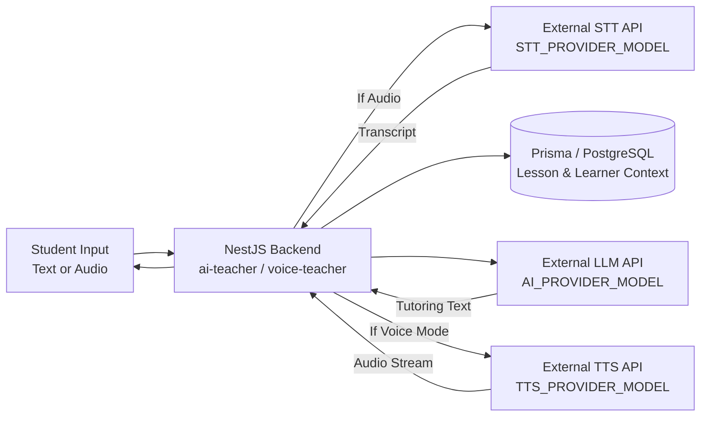

# 07 — AI Inference Pipeline

## 1. End-to-End Inference Flow in AIM

## 2. Key Inference Concepts
- **Prompt Construction**: Backend-only (`Keep adaptive decisions and provider credentials on the backend`, `README.md` line 56).
- **Decoding Parameters**: Temperature (controls randomness; lower = more deterministic grammar explanations), `top_p` (nucleus sampling), and `max_tokens` (caps latency and API cost).
- **Streaming & Compression**: `services/backend-api/src/main.ts` (lines 28–29) explicitly skips gzip compression for `text/event-stream` and `audio/` responses so SSE token streaming and voice audio are not buffered.
