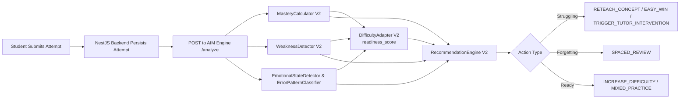

# 08 — Adaptive Learning System

## 1. Is the System Genuinely Adaptive?
**Honest Academic Answer**:
Yes, it is **genuinely adaptive** in the **rule-based / statistical heuristic** sense: student performance dynamically alters mastery, weakness profiles, difficulty levels, and next-action recommendations. However, it is **not** a machine-learning-trained adaptive system (such as Deep Knowledge Tracing or Item Response Theory calibrated via EM/MCMC on historical student logs).

## 2. Adaptive Learning Workflow (Mermaid)

## 3. Worked Example: How Incorrect Answers Affect a Student
Suppose a student has `mastery = 60`, `consistency = 50`, `retention = 80`, `reliability = 0.8`, `current_difficulty = 3`.
1. Initial `readiness_score`:
   $$0.45(60) + 0.25(50) + 0.20(80) + 0.10(80) = 27.0 + 12.5 + 16.0 + 8.0 = 63.5$$
2. The student submits 3 incorrect attempts with `hint_used = True`.
3. `WeaknessDetector` increases `error_frequency`, `hint_usage_rate`, and `weakness_score`.
4. `DifficultyAdapter.decide()` evaluates risk signals first (`repeated_failure_count`, `weakness_score`, `frustration_score`) and returns `DifficultyAction.DECREASE` (`target_difficulty = 2`).
5. `RecommendationEngine` selects `RETEACH_CONCEPT`, `EASY_WIN`, or `TRIGGER_TUTOR_INTERVENTION` (routing the student to the AI Teacher).

## 4. Comparison with Academic Alternatives
- **Bayesian Knowledge Tracing (BKT)**: Uses a Hidden Markov Model ($P(L_0), P(T), P(G), P(S)$). *AIM* uses deterministic weighted formulas instead, which are easier to explain and require no pre-collected training corpus.
- **Deep Knowledge Tracing (DKT)**: Uses LSTMs/Transformers on interaction sequences. Requires thousands of learners; impractical for an initial graduation project launch.
- **Item Response Theory (IRT)**: Models item difficulty $b_i$ and learner ability $\theta_j$ via logistic curves. *AIM* uses discrete difficulty levels `1..5` and weighted readiness scores.
