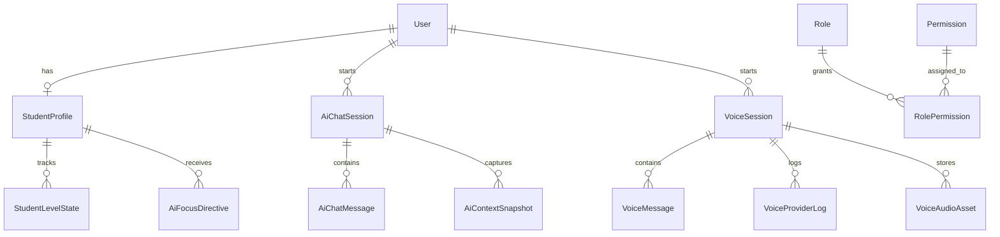

# 09 — Database Design (`services/backend-api/prisma/schema.prisma`)

## 1. Database Technology
- **PostgreSQL** (hosted on Supabase) accessed via **Prisma ORM 7.10.1** (`@prisma/client`).
- **Why PostgreSQL**: Strong ACID transactions, relational foreign keys for hierarchical curriculum (`Course` -> `Chapter` -> `Lesson`), RBAC (`Role`, `Permission`, `RolePermission`), and structured logging for AI/Voice sessions.

## 2. Core Entities & ER Diagram (Mermaid)

## 3. Key Models Observed in `schema.prisma`
- **Identity & RBAC**: `User`, `StudentProfile`, `Role`, `Permission`, `RolePermission`
- **AI & Voice Tutoring**: `AiChatSession`, `AiChatMessage`, `AiContextSnapshot`, `VoiceSession`, `VoiceMessage`, `VoiceProviderLog`, `VoiceAudioAsset`, `AiFocusDirective`
- **Curriculum & Progress**: `Course`, `StudentLevelState` (plus chapter/lesson/attempt/billing models).

## 4. Database Design Strengths & Weaknesses
- **Strengths**: Clean separation of `AiChatSession` vs `VoiceSession`, explicit `VoiceProviderLog` for debugging external STT/TTS latency/errors, and `AiContextSnapshot` for grounding AI responses.
- **Weaknesses**: Heavy reliance on `Prisma` migrations requires careful coordination with Supabase; `aim-engine` does not read PostgreSQL directly, meaning `backend-api` must serialize all learner context in the `POST /aim/v1/analysis` payload.
