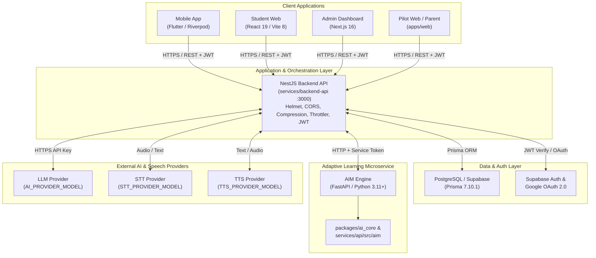
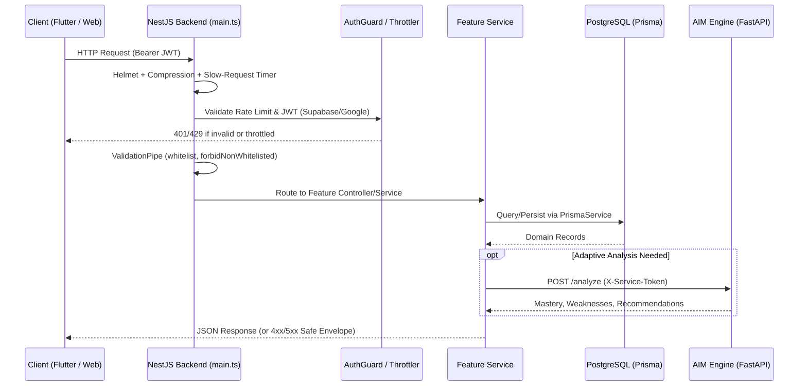
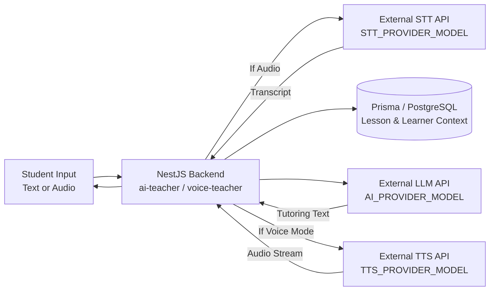
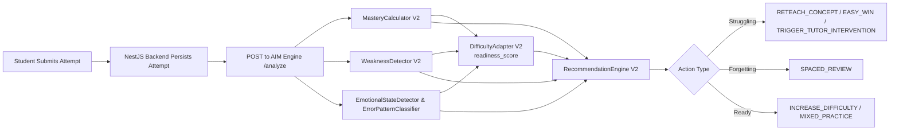
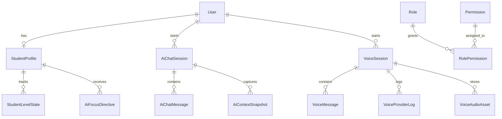

# AIM Platform — Complete Graduation Defense Guide


---

# 00 — Project Overview

## 1. What Is the AIM Platform?

### Simple Explanation (Non-Technical)
The **AIM Platform** is an intelligent, adaptive English-learning ecosystem designed for Arabic-speaking learners (with full Arabic RTL and English LTR support). Instead of giving every student the same static lessons, AIM watches how each student answers questions, detects their specific weaknesses (such as grammar rules, vocabulary retention, or pronunciation), adjusts exercise difficulty in real time, and provides an AI Teacher and Voice Teacher for interactive practice. It also includes an Admin Dashboard for content/operations management, a Student Web portal, and Parent Dashboard capabilities.

### Advanced Explanation (Technical Examiners)
**AIM Platform** is a polyglot, multi-service monorepo implementing an adaptive English-learning system:
- **Client Layer**:
  - `apps/mobile`: Flutter (`>=3.3.0 <4.0.0`) learner mobile app using `flutter_riverpod`, `go_router`, `flutter_secure_storage`, `record`, and `audioplayers`.
  - `apps/student-web`: React 19 + TypeScript + Vite 8 + Tailwind CSS web portal for students.
  - `apps/admin-dashboard`: Next.js 16 (`^16.2.9` / `16.4.6` in lockfile) + React 19 + TanStack Query + Zod internal admin portal.
  - `apps/web`: Retained pilot web application containing parent-dashboard functionality.
- **Application & Orchestration Layer**:
  - `services/backend-api`: NestJS 11 (`@nestjs/core ^11.1.27`) TypeScript API gateway and business-logic service using Prisma 7.10.1 (`@prisma/client`) over PostgreSQL (Supabase), JWT/Google OAuth (`passport-google-oauth20`), `@nestjs/throttler`, `helmet`, and `compression`.
- **Adaptive & AI Analysis Layer**:
  - `services/aim-engine`: Python 3.11+ FastAPI (`>=0.115.0`) microservice (`AimAnalysisPipelineEntrypoint`) that executes the adaptive-learning pipeline, importing domain algorithms from `services/api/src/aim/domain/services` and `packages/ai_core`.
  - `services/backend-api/src/features/ai-teacher` and `voice-teacher`: Integrates external LLM (`AI_PROVIDER_API_KEY`), Speech-to-Text (`STT_PROVIDER_API_KEY`), and Text-to-Speech (`TTS_PROVIDER_API_KEY`) providers, keeping all credentials and adaptive decisions on the backend.

---

## 2. Problem Statement & Importance

### What Problem Does It Solve?
1. **One-Size-Fits-All Language Learning**: Traditional e-learning platforms present a fixed linear curriculum regardless of a learner's prior knowledge, forgetting curve, or specific error patterns.
2. **Lack of Immediate, Contextualized Feedback**: Learners—especially Arabic speakers learning English—struggle with L1-to-L2 transfer errors (e.g., tense usage, prepositions, pronunciation) without an available tutor.
3. **Disconnected Assessment & Practice**: Placement tests, daily lessons, vocabulary review, and conversational practice are often siloed rather than feeding into a unified learner model.

### Why Is This Problem Important?
- Personalized, mastery-based instruction significantly improves retention and reduces learner frustration.
- Combining **quantitative adaptive modeling** (mastery calculation, retention tracking, weakness detection, difficulty adaptation) with **qualitative conversational AI** (AI Teacher & Voice Teacher) bridges the gap between structured curriculum and real-world communication.

---

## 3. Target Users

1. **Primary Users (Learners / Students)**: Arabic-speaking and English-learning students using `apps/mobile` (Flutter) or `apps/student-web` (React).
2. **Parents / Guardians**: Tracking student progress via parent-dashboard endpoints (`services/backend-api/src/features/parents`) and `apps/web`.
3. **Administrators & Content Managers**: Managing curriculum, billing/coupons, operations, and analytics via `apps/admin-dashboard` (Next.js).

---

## 4. Functional & Non-Functional Requirements

### Functional Requirements
- **Authentication & Onboarding**: Email/password & Google OAuth (`apps/mobile`, `services/backend-api/src/auth`), placement testing (`features/placement`).
- **Structured Curriculum**: Courses, chapters, lessons, exercises, vocabulary library (`features/curriculum`, `student-courses`, `student-chapters`, `student-lessons`, `vocabulary-library`).
- **Adaptive Learning Engine**: Performance analysis, mastery calculation, weakness detection, difficulty adaptation, retention tracking, and micro-goal/recommendation generation (`services/aim-engine`, `packages/ai_core`).
- **AI & Voice Tutoring**: Text-based AI Teacher (`features/ai-teacher`) and audio-based Voice Teacher (`features/voice-teacher`) with STT/TTS.
- **Engagement & Gamification**: Achievements, certificates, streaks/engagement, notifications (`features/achievements`, `certificates`, `engagement`, `notifications`).
- **Billing & Access Control**: Course billing, coupon/payment approval (`features/billing`, `course-billing`).

### Non-Functional Requirements
- **Security**: Backend-only adaptive decisions and API credentials, Helmet HTTP headers, CORS allowlisting, rate limiting (`@nestjs/throttler`), JWT verification (Supabase), `ValidationPipe` with `whitelist: true` and `forbidNonWhitelisted: true`.
- **Performance**: Gzip/Brotli response compression (`compression` threshold 1024 bytes, skipping `text/event-stream` and `audio/`), slow-request logging (`SLOW_REQUEST_MS=800`).
- **Localization**: Arabic (RTL) and English (LTR) support in `apps/mobile`.
- **Reliability & Maintainability**: Automated CI workflows, unit/integration test suites (Jest for Node, Pytest for Python, Flutter test), and artifact/security checks (`scripts/check-repository-artifacts.cjs`).

---

## 5. Differentiation, Contributions & Limitations

### What Makes AIM Different?
- **Hybrid Architecture**: Separates transactional/auth/API orchestration (NestJS + Prisma) from mathematical/adaptive analysis (Python FastAPI `aim-engine`).
- **Multi-Dimensional Learner Model**: `packages/ai_core` models not just accuracy, but confidence (`confidence_matrix.py`), retention (`retention_tracker.py`), error patterns (`error_pattern_classifier.py`), skill graphs (`skill_graph.py`), and emotional/frustration signals (`emotional_state_detector.py`).
- **Voice + Text AI Tutoring**: Real microphone recording (`record` package in Flutter) integrated with backend STT/LLM/TTS pipelines.

### Academic & Technical Contributions
- **Technical Contribution**: A production-structured, multi-client, polyglot microservices architecture with strict contract validation, comprehensive test suites (3,916 backend tests, 246 admin tests, 666 student-web tests reported in `CLEANUP_README.md`), and containerized deployment (`render.yaml`).
- **Academic Contribution**: Integration of rule-based/statistical adaptive learning algorithms (mastery, spaced retention, skill dependency graphs, difficulty adaptation) with LLM-based conversational tutoring.

### Honest Limitations (Critical Self-Awareness)
1. **No Custom-Trained LLM**: The AI Teacher uses external LLM/STT/TTS provider APIs (`AI_PROVIDER_API_KEY`), not a custom-trained or LoRA fine-tuned model.
2. **Heuristic/Rule-Based Adaptation**: The adaptive algorithms in `packages/ai_core` and `services/aim-engine` are primarily deterministic/statistical heuristics rather than deep-learning knowledge tracing (DKT) trained on large-scale student datasets.
3. **Legacy Tree Retention**: Both `services/api` and `apps/web` are retained alongside `services/aim-engine` and `apps/student-web`, creating architectural duplication that requires future consolidation.

---

# 01 — System Architecture

## 1. Architectural Patterns Used
1. **Polyglot Microservices / Service-Oriented Architecture (SOA)**:
   - `services/backend-api` (NestJS / TypeScript) handles client-facing REST APIs, authentication, database persistence, billing, and external AI/STT/TTS orchestration.
   - `services/aim-engine` (FastAPI / Python) handles adaptive-learning computation and analysis.
2. **Modular Monolith (within NestJS)**:
   - `services/backend-api/src/features/` organizes 30+ domain modules (`auth`, `ai-teacher`, `voice-teacher`, `aim`, `curriculum`, `billing`, etc.) under `FeaturesModule`.
3. **Feature-Sliced / Clean Layering (Mobile & Web)**:
   - `apps/mobile` uses Riverpod state management + `go_router` with feature-based directories.
   - `apps/admin-dashboard` uses Next.js App Router + TanStack Query.
4. **API Gateway / Backend-for-Frontend (BFF) Pattern**:
   - Clients never talk directly to `aim-engine`, PostgreSQL, or external AI/STT/TTS providers. All traffic routes through `services/backend-api`.

---

## 2. Overall System Architecture (Mermaid)



---

## 3. Request-Response Lifecycle (Mermaid)



---

## 4. Critical Evaluation of Architectural Decisions

| Decision | What Was Selected | Why Suitable | Alternatives | Pros & Cons | Was It the Best Choice? |
| :--- | :--- | :--- | :--- | :--- | :--- |
| **Backend Framework** | NestJS 11 (TypeScript) | Strong modularity, DI, built-in `ValidationPipe`, Swagger, Throttler. | Express.js, Fastify, Django/FastAPI monolith | **Pros**: Enterprise structure, type safety.<br>**Cons**: Boilerplate, heavier memory footprint. | **Yes**, for a 30+ feature API with multiple clients. |
| **Adaptive Engine** | Separate Python FastAPI (`aim-engine`) | Python ecosystem for data/ML (`ai_core`, `ml`), clean separation. | TypeScript inside NestJS | **Pros**: Decoupled scaling, Python ML readiness.<br>**Cons**: Network hop latency, two runtimes to deploy. | **Partially** — since `ai_core` is currently pure Python math/rules without heavy PyTorch/GPU inference, running it as a separate service adds deployment/network overhead, though it future-proofs ML integration. |
| **Database & ORM** | PostgreSQL (Supabase) + Prisma 7.10.1 | Relational integrity for curriculum, users, billing, and progress. | MongoDB, TypeORM, Drizzle | **Pros**: Type-safe queries, migrations.<br>**Cons**: Prisma 7 config/upgrade complexity. | **Yes**, relational data (courses -> chapters -> lessons -> attempts) fits PostgreSQL naturally. |
| **AI Tutoring** | External LLM/STT/TTS APIs via Backend | Zero GPU hosting cost, high-quality responses immediately. | Self-hosted Llama/Mistral + Whisper | **Pros**: Fast time-to-market, low ops cost.<br>**Cons**: Ongoing API cost, vendor dependency, no custom weights. | **Yes** for a graduation project budget; self-hosting an LLM on Render Starter plans is infeasible. |
| **Mobile Client** | Flutter + Riverpod + GoRouter | Single codebase for Android/iOS, strong RTL/LTR support. | React Native, Native Kotlin/Swift | **Pros**: Consistent UI, good audio/recording plugins.<br>**Cons**: SDK version lock sensitivity (3.44.0 vs 3.32.5). | **Yes**, well-suited for interactive educational UIs. |

---

# 02 — Complete File and Folder Structure

## 1. Repository Tree (Top-Level & Key Subtrees)

```text
aim-platform/
├── apps/
│   ├── mobile/                  # Flutter learner app (Riverpod, GoRouter, audio recording)
│   ├── student-web/             # React 19 + Vite 8 + Tailwind CSS student web portal
│   ├── admin-dashboard/         # Next.js 16 + React 19 + TanStack Query admin portal
│   └── web/                     # Retained pilot web app (includes parent-dashboard)
├── services/
│   ├── backend-api/             # NestJS 11 TypeScript API & BFF
│   │   ├── prisma/              # schema.prisma & migrations
│   │   └── src/
│   │       ├── main.ts          # Bootstrap: Helmet, Compression, CORS, ValidationPipe, OpenAPI
│   │       ├── app.module.ts    # Root module wiring Config, Prisma, Throttler, Features
│   │       ├── auth/            # Supabase JWT & Google OAuth 2.0 guards/strategies
│   │       ├── config/          # Environment & BackendConfigService
│   │       ├── database/        # PrismaService lifecycle
│   │       └── features/        # 30+ domain modules (ai-teacher, voice-teacher, aim, billing, etc.)
│   ├── aim-engine/              # Python 3.11+ FastAPI adaptive-learning microservice
│   │   └── app/
│   │       ├── main.py          # FastAPI factory, AimAnalysisPipelineEntrypoint, safe error handler
│   │       ├── api/             # router.py, analysis.py, system.py
│   │       ├── core/            # config.py, service_info.py, auth
│   │       ├── domain/          # Domain adapters
│   │       ├── errors/          # AimSafeFailureBuilder (no stack trace leaks)
│   │       ├── pipeline/        # AimAnalysisPipelineEntrypoint
│   │       ├── schemas/         # Pydantic v2 request/response contracts
│   │       └── validation/      # Input validation
│   └── api/                     # Legacy Python API; aim.domain.services still imported by aim-engine
├── packages/
│   ├── ai_core/                 # 14 Python adaptive-learning & cognitive modeling modules
│   ├── ml/                      # ML data pipeline, training, evaluation, A/B testing scripts
│   ├── content/                 # Shared curriculum/content assets
│   └── shared-contracts/        # Shared API/schema contracts
├── database/                    # SQL migrations, schema, and seed sources
├── infra/                       # Docker & infrastructure configuration
├── scripts/                     # Repository guard scripts (check-repository-artifacts.cjs)
├── docs/                        # Phase history, architecture, operations docs
├── render.yaml                  # Render.com Blueprint for aim-backend-api & aim-engine
└── CLEANUP_README.md            # Repository cleanup & verification audit
```

---

## 2. Most Important Files to Understand Before Your Defense

| File Path | Purpose & Why It Matters | What Happens If Removed |
| :--- | :--- | :--- |
| `services/backend-api/src/main.ts` | Entry point of the NestJS API; configures `helmet`, `compression`, `ValidationPipe`, CORS, trust proxy, and OpenAPI. | Backend API cannot start. |
| `services/backend-api/prisma/schema.prisma` | Defines the entire PostgreSQL relational data model (users, courses, lessons, attempts, billing). | Prisma client generation and all DB queries fail. |
| `services/backend-api/src/features/ai-teacher/` | Orchestrates LLM-based text tutoring using `AI_PROVIDER_API_KEY`. | AI Teacher chat stops working. |
| `services/backend-api/src/features/voice-teacher/` | Orchestrates STT -> LLM -> TTS voice tutoring pipeline. | Voice Teacher feature breaks. |
| `services/backend-api/src/features/aim/` | Bridges NestJS backend with the Python `aim-engine` service. | Adaptive recommendations/analysis stop. |
| `services/aim-engine/app/main.py` | FastAPI entry point initializing `AimAnalysisPipelineEntrypoint` and safe failure handling. | AIM Engine microservice cannot boot. |
| `services/aim-engine/app/pipeline/aim_analysis_pipeline.py` | Coordinates the end-to-end adaptive analysis pipeline. | `/analyze` endpoint fails. |
| `packages/ai_core/mastery_calculator.py` | Computes learner mastery scores per skill. | Mastery tracking breaks. |
| `packages/ai_core/weakness_detector.py` | Identifies weak skills and error patterns. | Weakness detection breaks. |
| `packages/ai_core/recommendation_engine.py` | Generates personalized next-step learning recommendations. | Adaptive lesson/exercise selection breaks. |
| `render.yaml` | Defines production deployment topology for Render. | Automated Render Blueprint deployment breaks. |

---

# 03 — Technology Stack: What, How, and Why

## 1. Backend & APIs
- **Node.js 24 + TypeScript (`^6.0.3`) + NestJS 11 (`@nestjs/core ^11.1.27`)**:
  - *What*: Enterprise-grade Node.js framework with dependency injection, modular architecture, and decorators.
  - *Where*: `services/backend-api/`.
  - *Why*: Enforces clean separation across 30+ domain modules (`features/`), built-in `ValidationPipe` (`class-validator`), `@nestjs/throttler` rate limiting, and `@nestjs/swagger` OpenAPI generation.
  - *Alternatives*: Express.js (less structured), Fastify (faster raw throughput, less batteries-included), Python Django/FastAPI monolith.
- **Prisma ORM (`7.10.1`) + PostgreSQL (`pg ^8.13.1`)**:
  - *What*: Type-safe ORM generating a TypeScript client from `schema.prisma`.
  - *Why*: Eliminates raw SQL boilerplate, prevents SQL injection via parameterized queries, and manages schema migrations.

## 2. Adaptive & AI Engine
- **Python 3.11+ + FastAPI (`>=0.115.0`) + Pydantic v2 (`>=2.8.0`) + Uvicorn**:
  - *What*: High-performance async Python web framework with automatic OpenAPI & strict runtime data validation.
  - *Where*: `services/aim-engine/`.
  - *Why*: Isolates adaptive-learning math (`packages/ai_core`) and ML tooling (`packages/ml`) in Python.

## 3. Frontend & Mobile Clients
- **Flutter (`sdk >=3.3.0 <4.0.0`) + Riverpod (`^2.5.1`) + GoRouter (`^14.6.2`)**:
  - *Where*: `apps/mobile/`.
  - *Why*: Cross-platform iOS/Android from one codebase, native RTL/LTR localization (`flutter_localizations`, `intl`), and hardware microphone/audio support (`record ^7.1.1`, `audioplayers ^6.8.1`).
- **React 19 + Vite 8 (`^8.0.0`) + Tailwind CSS (`^3.4.17`)**:
  - *Where*: `apps/student-web/`. (Migrated from `react-scripts` to Vite 8, reducing npm audit advisories from 31 to 0).
- **Next.js 16 (`16.4.6`) + React 19 + TanStack Query + Zod**:
  - *Where*: `apps/admin-dashboard/`.

## 4. Authentication, Security & Deployment
- **Supabase Auth + `passport-google-oauth20`**: JWT-based stateless authentication (`SUPABASE_JWT_SECRET`, `SUPABASE_JWT_ISSUER`).
- **Helmet (`^8.2.0`) & Compression (`^1.8.2`)**: HTTP security headers and gzip/brotli response compression.
- **Render (`render.yaml`) + Docker**: Containerized deployment for `aim-backend-api` and `aim-engine`.

---

# 04 — Core Algorithms and Business Logic

## 1. Ranking of Algorithms in the AIM Platform

1. **Mastery Calculation V2** (`services/api/src/aim/domain/services/mastery_calculator.py`) — *Core Algorithm*
2. **Weakness Detection V2** (`services/api/src/aim/domain/services/weakness_detector.py`) — *Core Algorithm*
3. **Difficulty Adaptation V2** (`services/api/src/aim/domain/services/difficulty_adapter.py`) — *Core Algorithm*
4. **Recommendation Engine V2** (`services/api/src/aim/domain/services/recommendation_engine.py`) — *Core Orchestration Algorithm*
5. **Supporting Cognitive & Reliability Algorithms** (`services/api/src/aim/domain/services/`):
   - `evidence_quality_engine.py`, `reliability_engine.py`, `retention_tracker.py`, `confidence_matrix.py`, `emotional_state_detector.py`, `error_pattern_classifier.py`, `micro_goal_generator.py`, `transfer_learning_detector.py`, `contextual_memory.py`.

---

## 2. Mastery Calculation V2 (`mastery_calculator.py`)
- **Purpose**: Computes a stabilized mastery score `[0, 100]` for a `(student_id, skill_id)` pair.
- **Key Design Decision**: *"Response time is intentionally excluded from mastery and from this module's attempt snapshot contract."* (Lines 3–4). This prevents penalizing thoughtful or slower learners who answer accurately.
- **Inputs**: `AttemptSnapshot(is_correct, attempts, difficulty, skip, hint_used)` and `SkillState(retention, confidence, mastery)`.
- **Supporting Engines**: Uses `EvidenceQualityEngine` and `ReliabilityEngine` to weight attempt evidence before updating `SkillStateRepository.update_mastery()`.

## 3. Weakness Detection V2 (`weakness_detector.py`)
- **Purpose**: Computes an explainable `SkillWeakness` score and severity (`"low" | "medium" | "high"`) per skill.
- **Inputs**: `WeaknessAttempt(student_id, skill_id, is_correct, difficulty, skip, hint_used, attempts)` plus optional `hesitation_index_by_skill`, `retention_drop_by_skill`, and `prerequisite_gap_by_skill`.
- **Outputs**: `SkillWeakness` containing `weakness_score`, `error_frequency`, `hint_usage_rate`, `retry_rate`, `skip_rate`, `hesitation_index`, `retention_drop`, `prerequisite_gap_score`, and `main_weaknesses`.

## 4. Difficulty Adaptation V2 (`difficulty_adapter.py`)
- **Purpose**: Conservatively adjusts question difficulty (`MIN_DIFFICULTY = 1` to `MAX_DIFFICULTY = 5`) returning `DifficultyAction` (`INCREASE`, `MAINTAIN`, `DECREASE`).
- **Mathematical Formula** (Lines 61–67):
  $$\text{readiness\_score} = \text{round}(0.45 \cdot \text{mastery} + 0.25 \cdot \text{consistency} + 0.20 \cdot \text{retention} + 0.10 \cdot (\text{reliability} \times 100), 2)$$
- **Safety-First Rule** (Line 79): Risk signals (`weakness_score`, `frustration_score`, `repeated_failure_count`) are evaluated *first* to trigger `DECREASE` before considering `INCREASE`.
- **Complexity**: $O(1)$ time and $O(1)$ space per decision.

## 5. Recommendation Engine V2 (`recommendation_engine.py`)
- **Purpose**: Selects the next pedagogical action (`RecommendationActionType`):
  - `COLLECT_MORE_EVIDENCE`, `EASY_WIN`, `REVIEW_PREREQUISITE`, `RETEACH_CONCEPT`, `TARGETED_PRACTICE`, `SPACED_REVIEW`, `CONFIDENCE_BUILDER`, `REFLECTION_PRACTICE`, `MIXED_PRACTICE`, `INCREASE_DIFFICULTY`, `CONTINUE_CURRENT_SKILL`, `TRIGGER_TUTOR_INTERVENTION`.
- **How It Works**: Combines outputs from `ConfidenceMatrix`, `ContextualMemory`, `DifficultyAdapter`, `EmotionalStateDetector`, `ErrorPatternClassifier`, `MicroGoalGenerator`, `WeaknessDetector`, and `SkillGraph`.

---

# 05 — AI Fundamentals

## 1. What AI Components Exist in the AIM Platform?
In the AIM Platform, "AI" is split into two distinct subsystems:
1. **Symbolic / Statistical Adaptive AI (`services/aim-engine` + `packages/ai_core`)**: Deterministic cognitive modeling (mastery, weakness, retention, difficulty, recommendations).
2. **Generative & Speech AI (`services/backend-api/src/features/ai-teacher` & `voice-teacher`)**: Calls external hosted foundation models via API keys (`AI_PROVIDER_API_KEY`, `AI_PROVIDER_MODEL`, `STT_PROVIDER_API_KEY`, `TTS_PROVIDER_API_KEY` in `render.yaml`).

## 2. Transformer & LLM Concepts (For Defense Questions)
Even though AIM calls an external LLM API rather than hosting weights locally, examiners will test whether you understand how the underlying LLM works:
- **Transformer Architecture**: Relies on **Self-Attention** ($\text{Attention}(Q,K,V) = \text{softmax}\left(\frac{QK^T}{\sqrt{d_k}}\right)V$) to weigh relationships between all tokens in a context window simultaneously.
- **Tokenization & Embeddings**: Text is split into subword tokens (e.g., BPE) and mapped to dense vectors + positional encodings.
- **Autoregressive Generation**: The model predicts one next token at a time conditioned on all previous tokens (system prompt + learner context + chat history).

## 3. Genuine AI Contribution of This Project
- **What we did NOT build**: We did not train an LLM from scratch or fine-tune LoRA weights.
- **What we DID build**: Context-aware pedagogical orchestration—injecting the learner's adaptive profile (mastery, weaknesses, lesson context) into structured backend prompts and combining it with real-time STT/TTS voice interaction.

---

# 06 — Model Training & Fine-Tuning (Actual Status vs. Theory)

## 1. Actual Implementation Status in the Repository
- **LLM Fine-Tuning / LoRA**: **Not implemented** in this repository. The AI Teacher (`services/backend-api/src/features/ai-teacher`) uses an external LLM API (`AI_PROVIDER_MODEL` + `AI_PROVIDER_API_KEY`).
- **ML Scaffolding (`packages/ml/`)**: Contains `data_pipeline.py`, `train_recommendation_model.py`, `evaluation.py`, and `ab_test_framework.py` for future supervised/recommendation model training, but the live `services/aim-engine` runs the deterministic `services/api/src/aim/domain/services/` algorithms.

## 2. Why External API + Prompting Was Chosen Over Fine-Tuning
1. **Zero GPU Infrastructure Cost**: Fine-tuning and hosting a 7B–70B parameter LLM requires dedicated GPUs (e.g., A100/L40S), which is incompatible with Render Starter plans (`render.yaml`).
2. **Data Availability**: Supervised fine-tuning (SFT) or LoRA requires thousands of curated, high-quality Arabic-English tutoring dialogues.
3. **Rapid Iteration**: Prompt engineering + adaptive context injection allows immediate pedagogical tuning without retraining cycles.

## 3. Defense-Ready Explanation (If Asked About LoRA / Fine-Tuning)
If an examiner asks *"Why didn't you fine-tune Llama/Mistral with LoRA?"*, answer:
> *"We evaluated fine-tuning (LoRA adapts low-rank matrices $W + \Delta W = W + BA$ with rank $r \ll d$), which is ideal when you have a large domain-specific dataset and GPU hosting. However, for our graduation project, our core innovation is the **adaptive learner model** (`aim-engine`) coupled with **context-injected LLM tutoring** via external APIs. This avoids GPU hosting costs and prevents hallucination-prone small local models from degrading English grammar explanations."*

---

# 07 — AI Inference Pipeline

## 1. End-to-End Inference Flow in AIM



## 2. Key Inference Concepts
- **Prompt Construction**: Backend-only (`Keep adaptive decisions and provider credentials on the backend`, `README.md` line 56).
- **Decoding Parameters**: Temperature (controls randomness; lower = more deterministic grammar explanations), `top_p` (nucleus sampling), and `max_tokens` (caps latency and API cost).
- **Streaming & Compression**: `services/backend-api/src/main.ts` (lines 28–29) explicitly skips gzip compression for `text/event-stream` and `audio/` responses so SSE token streaming and voice audio are not buffered.

---

# 08 — Adaptive Learning System

## 1. Is the System Genuinely Adaptive?
**Honest Academic Answer**:
Yes, it is **genuinely adaptive** in the **rule-based / statistical heuristic** sense: student performance dynamically alters mastery, weakness profiles, difficulty levels, and next-action recommendations. However, it is **not** a machine-learning-trained adaptive system (such as Deep Knowledge Tracing or Item Response Theory calibrated via EM/MCMC on historical student logs).

## 2. Adaptive Learning Workflow (Mermaid)



## 3. Worked Example: How Incorrect Answers Affect a Student
Suppose a student has `mastery = 60`, `consistency = 50`, `retention = 80`, `reliability = 0.8`, `current_difficulty = 3`.
1. Initial `readiness_score`:
   $$0.45(60) + 0.25(50) + 0.20(80) + 0.10(80) = 27.0 + 12.5 + 16.0 + 8.0 = 63.5$$
2. The student submits 3 incorrect attempts with `hint_used = True`.
3. `WeaknessDetector` increases `error_frequency`, `hint_usage_rate`, and `weakness_score`.
4. `DifficultyAdapter.decide()` evaluates risk signals first (`repeated_failure_count`, `weakness_score`, `frustration_score`) and returns `DifficultyAction.DECREASE` (`target_difficulty = 2`).
5. `RecommendationEngine` selects `RETEACH_CONCEPT`, `EASY_WIN`, or `TRIGGER_TUTOR_INTERVENTION` (routing the student to the AI Teacher).

## 4. Comparison with Academic Alternatives
- **Bayesian Knowledge Tracing (BKT)**: Uses a Hidden Markov Model ($P(L_0), P(T), P(G), P(S)$). *AIM* uses deterministic weighted formulas instead, which are easier to explain and require no pre-collected training corpus.
- **Deep Knowledge Tracing (DKT)**: Uses LSTMs/Transformers on interaction sequences. Requires thousands of learners; impractical for an initial graduation project launch.
- **Item Response Theory (IRT)**: Models item difficulty $b_i$ and learner ability $\theta_j$ via logistic curves. *AIM* uses discrete difficulty levels `1..5` and weighted readiness scores.

---

# 09 — Database Design (`services/backend-api/prisma/schema.prisma`)

## 1. Database Technology
- **PostgreSQL** (hosted on Supabase) accessed via **Prisma ORM 7.10.1** (`@prisma/client`).
- **Why PostgreSQL**: Strong ACID transactions, relational foreign keys for hierarchical curriculum (`Course` -> `Chapter` -> `Lesson`), RBAC (`Role`, `Permission`, `RolePermission`), and structured logging for AI/Voice sessions.

## 2. Core Entities & ER Diagram (Mermaid)



## 3. Key Models Observed in `schema.prisma`
- **Identity & RBAC**: `User`, `StudentProfile`, `Role`, `Permission`, `RolePermission`
- **AI & Voice Tutoring**: `AiChatSession`, `AiChatMessage`, `AiContextSnapshot`, `VoiceSession`, `VoiceMessage`, `VoiceProviderLog`, `VoiceAudioAsset`, `AiFocusDirective`
- **Curriculum & Progress**: `Course`, `StudentLevelState` (plus chapter/lesson/attempt/billing models).

## 4. Database Design Strengths & Weaknesses
- **Strengths**: Clean separation of `AiChatSession` vs `VoiceSession`, explicit `VoiceProviderLog` for debugging external STT/TTS latency/errors, and `AiContextSnapshot` for grounding AI responses.
- **Weaknesses**: Heavy reliance on `Prisma` migrations requires careful coordination with Supabase; `aim-engine` does not read PostgreSQL directly, meaning `backend-api` must serialize all learner context in the `POST /aim/v1/analysis` payload.

---

# 10 — APIs and Communication

## 1. Communication Architecture
- **Clients -> Backend API**: HTTPS REST + JSON (with Bearer JWT from Supabase/Google OAuth).
- **Backend API -> AIM Engine**: Internal HTTP `POST /aim/v1/analysis` (`services/aim-engine/app/api/analysis.py`) authenticated via `AIM_ENGINE_SERVICE_TOKEN` (`HTTPBearer`).
- **Backend API -> External AI/Speech**: HTTPS REST calls using `AI_PROVIDER_API_KEY`, `STT_PROVIDER_API_KEY`, `TTS_PROVIDER_API_KEY`.

## 2. Key Backend Feature Modules (`services/backend-api/src/features/`)
- `auth/` — Login, registration, Google OAuth, JWT validation.
- `placement/` — Initial placement test.
- `student-home/`, `student-courses/`, `student-chapters/`, `student-lessons/` — Learner curriculum navigation.
- `practice/`, `assessments/` — Exercise submission and grading.
- `aim/` — Adapter calling `aim-engine` `POST /aim/v1/analysis`.
- `ai-teacher/` — Text-based AI tutor chat.
- `voice-teacher/` — Audio STT -> LLM -> TTS voice tutor.
- `billing/`, `course-billing/` — Course purchases and coupon approval.
- `parents/`, `admin/`, `reports/`, `analytics/` — Parent & Admin dashboards.

## 3. Security & Validation on Every Endpoint
- `ValidationPipe({ whitelist: true, forbidNonWhitelisted: true, transform: true })` in `services/backend-api/src/main.ts` strips/rejects unknown fields.
- `@nestjs/throttler` enforces rate limiting per real client IP (`trust proxy` = 1).
- `aim-engine` never logs raw request/response bodies or service tokens (`analysis.py` lines 24–28).

---

# 11 — Complete Feature Execution Flows

## Flow 1: User Login (Mobile / Web)
`User enters credentials or taps Google Sign-In` → `apps/mobile` (`google_sign_in` / `http`) → `POST /auth/...` → `services/backend-api/src/auth` → `Supabase Auth / Google OAuth` → `Prisma User/StudentProfile lookup` → `JWT returned` → `Stored in flutter_secure_storage`.

## Flow 2: Student Submits Exercise & Adaptive Update
`Student answers question` → `apps/mobile` / `student-web` → `POST /practice/...` → `services/backend-api/src/features/practice` → `Prisma saves attempt` → `features/aim` calls `POST /aim/v1/analysis` on `aim-engine` → `AimAnalysisPipelineEntrypoint` runs `MasteryCalculator`, `WeaknessDetector`, `DifficultyAdapter`, `RecommendationEngine` → `Returns next action & target difficulty` → `UI updates`.

## Flow 3: Voice Teacher Turn
`Student holds mic button` → `apps/mobile` (`record` package) → `Uploads audio` → `POST /voice-teacher/...` → `services/backend-api/src/features/voice-teacher` → `External STT API` → `Transcript + AiContextSnapshot` → `External LLM API` → `External TTS API` → `Audio + text returned` → `apps/mobile` plays via `audioplayers`.

---

# 12 — Security Analysis

## 1. Implemented Security Controls
- **HTTP Headers & CORS**: `helmet()` and explicit `CORS_ORIGINS` allowlist in `services/backend-api/src/main.ts`.
- **Input Validation**: Global `ValidationPipe({ whitelist: true, forbidNonWhitelisted: true, transform: true })` prevents mass-assignment/prototype pollution.
- **Rate Limiting**: `@nestjs/throttler` with `trust proxy` = 1 (`main.ts` lines 17–18) so rate limits apply per real client IP behind nginx/Render.
- **Authentication**: Supabase JWT verification (`SUPABASE_JWT_SECRET`, `SUPABASE_JWT_ISSUER`, `SUPABASE_JWT_AUDIENCE`) + Google OAuth 2.0 (`passport-google-oauth20`). Mobile stores tokens in `flutter_secure_storage`.
- **Service-to-Service Auth**: `aim-engine` `/aim/v1/analysis` enforces `HTTPBearer` token verified with `secrets.compare_digest` (constant-time comparison).
- **Safe Error Handling**: `AimSafeFailureBuilder` in `aim-engine/app/main.py` strips stack traces and exception messages from HTTP responses.
- **SQL Injection Protection**: Prisma ORM parameterized queries.
- **Secrets Hygiene**: `scripts/check-repository-artifacts.cjs` rejects tracked `.db` or local account files.

## 2. Recommended Improvements & Known Risks
- **Credential Rotation**: `CLEANUP_README.md` notes 7 exposed pilot account passwords in Git history (`pilot_accounts.local.md` was removed from the working tree, but history purge/password reset is still required).
- **Remaining npm Audit Advisories**: Backend has 6 advisories (3 high via Prisma 7 `@prisma/config` -> `effect`, 3 moderate); Admin has 18 moderate advisories.
- **Prompt Injection**: Backend should enforce strict system-prompt boundaries and output length/schema checks when passing user text to `AI_PROVIDER_MODEL`.

---

# 13 — Testing and Evaluation

## 1. Verified Test Suites (from `CLEANUP_README.md`)
| Component | Command | Verified Result |
| :--- | :--- | :--- |
| **Backend API** | `npm test -- --runInBand` | 370 suites passed (4 skipped), 3,916 tests passed (49 skipped), 0 failures |
| **Admin Dashboard** | `npm test -- --runInBand` | 35 suites / 246 tests passed |
| **Student Web** | `npm test -- --runInBand` | 70 suites / 666 tests passed |
| **Flutter Mobile** | `flutter test` / `analyze` | Not run to completion locally (SDK 3.32.5 vs required >=3.44.0) |
| **AIM Engine** | `pytest` (`--cov=app --cov-fail-under=60`) | Configured in `pyproject.toml`; not rerun locally after cleanup |

## 2. Missing Evaluation & How to Defend It
- **AI / Pedagogical Evaluation**: There are no measured A/B test results or human-evaluated BLEU/rubric scores for AI Teacher responses or longitudinal learning-gain studies in the repository.
- **Defense Strategy**: Acknowledge this honestly as a **limitation / future work**, and propose a concrete evaluation plan (pre/post-test learning gains, teacher rubric grading of 100 AI Teacher responses for Arabic-English accuracy, and latency benchmarking).

---

# 14 — Deployment and Infrastructure (`render.yaml`)

## 1. Production Topology (Render Blueprint)
`render.yaml` defines two containerized Docker web services:
1. **`aim-backend-api`**:
   - Root: `services/backend-api`, Port: `3000`, Health check: `/health`, `autoDeploy: false`.
   - Connects to external **Supabase** (PostgreSQL + Auth), **AIM Engine** (`AIM_ENGINE_URL`), and **AI/STT/TTS Providers**.
2. **`aim-engine`**:
   - Dockerfile: `services/aim-engine/Dockerfile`, Health check: `/health`, `autoDeploy: true`.
   - Protected by `AIM_ENGINE_SERVICE_TOKEN`.

## 2. Scalability Analysis (Estimates)
- **10–100 concurrent users**: Render Starter plan handles this easily; `aim-engine` math is $O(1)$ per request.
- **1,000–10,000 concurrent users**: Bottlenecks will be (1) external LLM/STT/TTS API rate limits and latency, (2) PostgreSQL connection pooling (requires PgBouncer/Supabase pooler), and (3) single-instance Render Starter CPU/RAM.

---

# 15 — Critical Academic Evaluation

## Strongest Aspects
1. **Production-Grade Engineering**: 3,916 backend tests, strict DTO validation, Helmet/Throttler, and clean separation of `backend-api` and `aim-engine`.
2. **Explainable Adaptive Logic**: Every decision in `MasteryCalculator`, `WeaknessDetector`, `DifficultyAdapter`, and `RecommendationEngine` returns structured `evidence` rather than a black-box score.
3. **Real Voice & Mobile Integration**: Full Flutter app with RTL/LTR support and real microphone recording (`record` + `audioplayers`).

## Weakest Aspects & How to Defend Them
1. **No Custom-Trained ML/LLM Model**: *Defense*: External APIs + deterministic adaptive modeling avoid GPU costs and hallucinations while focusing on pedagogical orchestration.
2. **No Longitudinal Learning-Gain Study**: *Defense*: Propose a controlled pre/post-test pilot study as Future Work.
3. **Legacy Code Retention (`services/api`, `apps/web`)**: *Defense*: Retained deliberately to avoid breaking `aim-engine` imports (`services/api/src/aim/domain/services`) and parent-dashboard features (`apps/web`).

---

# 16 — Graduation Defense Question Bank

## 1. General & Contribution Questions
1. **What exactly did you develop yourself?**
   - *EN*: We architected and implemented the multi-client AIM Platform: the NestJS backend (`services/backend-api`), the FastAPI adaptive engine (`services/aim-engine`) with explainable mastery/weakness/difficulty/recommendation algorithms (`services/api/src/aim/domain/services`), the PostgreSQL/Prisma schema, and the Flutter/React/Next.js interfaces.
   - *AR*: قمنا بتصميم وتطوير منصة AIM متعددة الواجهات: الخادم الخل�ي بـ NestJS، ومحرك التعلم التكي�ي بـ FastAPI مع خوارزميات حساب الإتقان واكتشا� نقاط الضع� وتكيي� الصعوبة، وقاعدة بيانات PostgreSQL عبر Prisma، وتطبيقات Flutter و React و Next.js.
2. **Why not just use ChatGPT directly?**
   - *EN*: ChatGPT has no persistent learner model, no structured curriculum state, no mastery/retention tracking, and cannot enforce difficulty adaptation or Arabic-English pedagogical guardrails.

## 2. Adaptive Learning & AI Questions
3. **Why is response time excluded from `MasteryCalculator`?**
   - *EN*: `mastery_calculator.py` intentionally excludes response time so thoughtful learners are not penalized for reading carefully; speed is handled separately from mastery evidence.
4. **How does `DifficultyAdapter` decide to increase or decrease difficulty?**
   - *EN*: It computes `readiness_score = 0.45*mastery + 0.25*consistency + 0.20*retention + 0.10*(reliability*100)`, but evaluates risk signals (`weakness_score`, `frustration_score`, `repeated_failure_count`) **first** to safely decrease difficulty before considering an increase.
5. **Why didn't you fine-tune your own LLM?**
   - *EN*: Fine-tuning requires large curated datasets and GPU hosting. Our contribution is the **adaptive learner model + context-injected orchestration** using external LLM/STT/TTS APIs, which is cost-effective and avoids small-model hallucinations.

## 3. Architecture, Security & Database Questions
6. **Why separate `services/backend-api` (NestJS) and `services/aim-engine` (FastAPI)?**
   - *EN*: Separation of concerns: NestJS handles auth, RBAC, Prisma DB, and billing; Python/FastAPI isolates adaptive math and future ML (`packages/ml`) behind an internal `HTTPBearer` service token.
7. **How do you prevent SQL Injection and Mass Assignment?**
   - *EN*: Prisma ORM uses parameterized queries, and NestJS `ValidationPipe` (`whitelist: true, forbidNonWhitelisted: true`) strips/rejects unexpected fields.
8. **How do you prove your system works?**
   - *EN*: Automated verification: 3,916 backend tests, 246 admin tests, and 666 student-web tests pass locally (`CLEANUP_README.md`).

---

# 17 — Technical Glossary (English & Arabic)

- **Adaptive Learning (التعلم التكي�ي)**: Adjusting content difficulty and next actions dynamically based on learner performance.
- **Mastery (الإتقان)**: Estimated probability/score `[0, 100]` that a student has learned a skill.
- **BFF / API Gateway (بوابة الواجهة البرمجية)**: Single backend entry point (`services/backend-api`) mediating all client requests.
- **ORM (تخطيط الكائنات بالعلاقات)**: Prisma ORM maps TypeScript objects to PostgreSQL tables safely.
- **JWT (رمز ويب JSON)**: Stateless signed token issued by Supabase Auth for authenticating API requests.
- **STT / TTS (تحويل الكلام إلى نص / النص إلى كلام)**: Speech-to-Text and Text-to-Speech external APIs used by `voice-teacher`.
- **RBAC (التحكم بالوصول المبني على الأدوار)**: `Role`, `Permission`, `RolePermission` models in `schema.prisma`.

---

# 18 — Personalized Study Roadmap

1. **Day 1 — Architecture & Data**: Read `00-Project-Overview.md`, `01-System-Architecture.md`, and `09-Database-Design.md`. Practice drawing the Mermaid system diagram from memory.
2. **Day 2 — Core Algorithms**: Read `04-Core-Algorithms.md` and `08-Adaptive-Learning.md`. Memorize the `readiness_score` formula and why response time is excluded from `MasteryCalculator`.
3. **Day 3 — AI & Security**: Read `05-AI-Fundamentals.md`, `06-Model-Training.md`, `07-AI-Inference.md`, and `12-Security.md`. Be ready to explain why external LLM APIs were chosen over local fine-tuning.
4. **Day 4 — Mock Defense**: Review `16-Defense-Question-Bank.md` and `19-Defense-Cheat-Sheet.md`, then start an interactive mock defense!

---

# 19 — Defense Cheat Sheet (Quick Reference)

- **Backend**: NestJS 11 + TypeScript + Prisma 7.10.1 + PostgreSQL (Supabase), Port `3000`.
- **Adaptive Engine**: Python 3.11+ FastAPI (`services/aim-engine`), endpoint `POST /aim/v1/analysis`, protected by `AIM_ENGINE_SERVICE_TOKEN`.
- **Mobile**: Flutter + Riverpod + GoRouter + `record` + `audioplayers` + `flutter_secure_storage`.
- **Web**: `student-web` (React 19 + Vite 8), `admin-dashboard` (Next.js 16 + TanStack Query).
- **Readiness Formula**: `0.45*mastery + 0.25*consistency + 0.20*retention + 0.10*(reliability*100)`.
- **Test Counts**: Backend `3,916` passed; Admin `246` passed; Student Web `666` passed.

---

# 20 — Evidence and Implementation Matrix

| Project Claim | Actual File / Symbol | Verification Status |
| :--- | :--- | :--- |
| **NestJS Backend with Security Middleware** | `services/backend-api/src/main.ts` (`helmet`, `compression`, `ValidationPipe`) | Verified in source; 3,916 tests pass (`CLEANUP_README.md`) |
| **FastAPI Adaptive Engine** | `services/aim-engine/app/main.py` (`AimAnalysisPipelineEntrypoint`) | Verified in source |
| **Service-Token Guard on `/aim/v1/analysis`** | `services/aim-engine/app/api/analysis.py` (`secrets.compare_digest`) | Verified in source |
| **Mastery Calculation V2 (No Speed)** | `services/api/src/aim/domain/services/mastery_calculator.py` (`AttemptSnapshot`) | Verified in source |
| **Weakness Detection V2** | `services/api/src/aim/domain/services/weakness_detector.py` (`WeaknessDetector`) | Verified in source |
| **Difficulty Adaptation V2** | `services/api/src/aim/domain/services/difficulty_adapter.py` (`DifficultyAdapter.decide`) | Verified in source |
| **Recommendation Engine V2** | `services/api/src/aim/domain/services/recommendation_engine.py` (`RecommendationActionType`) | Verified in source |
| **PostgreSQL + Prisma Schema** | `services/backend-api/prisma/schema.prisma` (`User`, `AiChatSession`, `VoiceSession`) | Verified in source |
| **External AI/STT/TTS Integration** | `render.yaml` (`AI_PROVIDER_API_KEY`, `STT_PROVIDER_API_KEY`, `TTS_PROVIDER_API_KEY`) | Verified in config |
| **Flutter Mobile Audio & Auth** | `apps/mobile/pubspec.yaml` (`record`, `audioplayers`, `google_sign_in`) | Verified in manifest |
